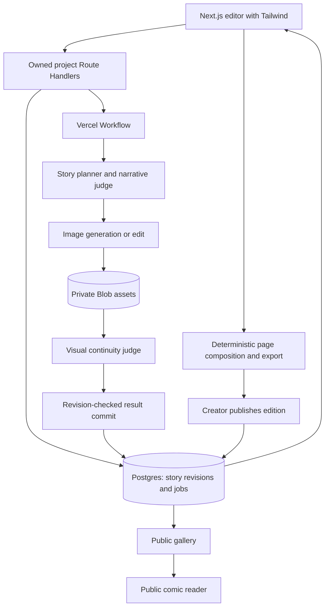
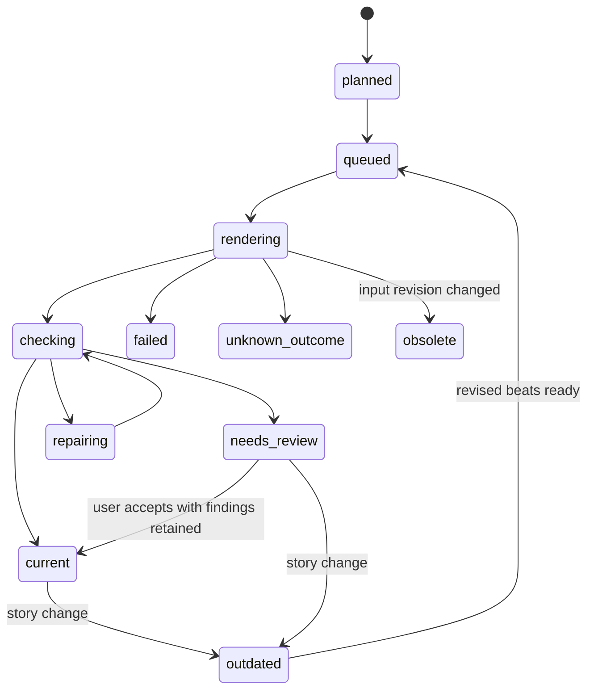
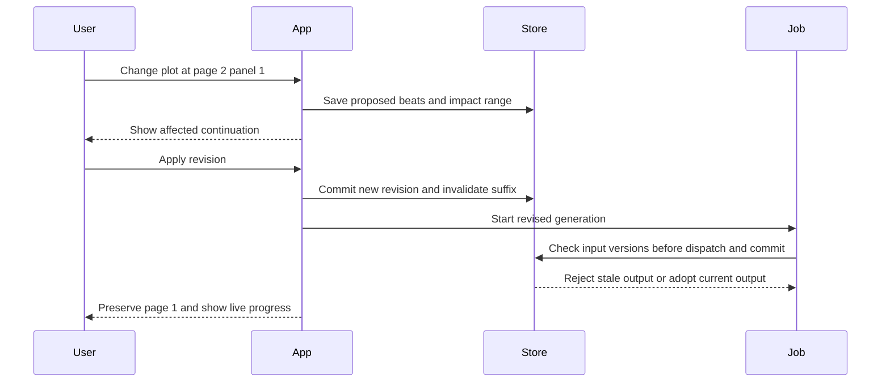

# Comex Hackathon - Plan

## Goal Capsule

- **Objective:** A creator can generate, revise, and publish a coherent comic; other visitors can discover and read published comics.
- **Means:** Next.js, TypeScript, Tailwind CSS, Bun, OpenAI, and Vercel, with versioned story state and separately rendered panels (KTD1–KTD12).
- **Deadline:** 1 November 2026, 17:00 Europe/London. Reserve the final hour for the demo, documentation, and submission links.
- **Authority:** Confirmed product requirements below govern scope. Numeric demo limits and untested technical choices remain explicit assumptions. Application implementation is reserved for the subsequent Terra execution; this artifact does not start it.
- **Delivery:** One application and one reviewable implementation branch/PR, with a working public Vercel deployment. Repository creation and the Vercel deployment direction are authorized. No release version or tag is needed.
- **Stop conditions:** Do not expose credentials, replace protected workspace metadata, publish obsolete renders as current, or represent mocked/image-tool results as proof of account API access.

---

## Product Contract

### Summary

Comex guides a visitor from plot and style selection through character approval to page-by-page comic generation. The visitor can replace artwork or change the story. Story changes update the affected continuation, and automated checks help catch narrative and visual drift. Creators optionally publish completed editions; readers browse the public gallery and open a comic without signing in.

### Problem Frame

Independent image generations can produce attractive panels that disagree about characters, props, or events. A short hackathon build needs a complete, understandable journey and reusable prompts, with enough automated verification to avoid spending the afternoon manually inspecting every iteration.

### Key Decisions

- **Story edits propagate.** Governs R5. (session-settled: user-directed — chosen over artwork-only edits: the user explicitly wants plot changes to update affected later pages.)
- **Tailwind CSS is required.** Governs R10. User directive.
- **Public GitHub, Vercel, and 1Password-backed secrets.** Governs R9–R11. User directive; deployment credentials and account entitlement still need verification.
- **Use LLM verification extensively.** Governs R6 and R8. It supplements exact software checks and a small human acceptance pass.
- **Creators publish; readers browse and read.** Governs R13–R15. (session-settled: user-directed — public publishing, gallery, and reader are required; comic forking is future scope, excluded from this demo.)
- **The whole interface resembles an eighties comic book.** Governs R16. The user selected Secret Wars #1 (1984) as the primary reference. Use the Terra design reference; interface styling is independent of the generated comic style.

### Requirements

**Create and render**

- R1. Visitors choose a visual style and briefly describe their plot.
- R2. The app asks tailored questions that resolve missing narrative choices without asking again for information already supplied.
- R3. Visitors can create and select characters, customize their cards, and approve their visual references before rendering.
- R4. Comics are generated page by page with consistent characters, style, plot, and scene transitions.

**Revise and verify**

- R5. Visitors can regenerate one panel or a whole page, and plot changes revise and regenerate affected later content while preserving the unaffected prefix.
- R6. The app checks character consistency across the comic and presents actionable findings with uncertainty where the evidence is inconclusive.
- R7. Prepare reusable prompts for narrative refinement, character creation, style presets, story planning, panel rendering, targeted edits, consistency checking, and downstream story revision.
- R8. Automate narrative, style, and visual-continuity evaluation, and measure the evaluators against deliberately correct and incorrect examples.

**Delivery**

- R9. Provide a public repository with README, setup instructions, credits, a demo video no longer than 90 seconds, and a concrete example of Codex's contribution.
- R10. Use Tailwind CSS for the frontend and target a public Vercel deployment.
- R11. Store application credentials in 1Password and integrate secret retrieval with GitHub Actions; keep secrets and personal data out of the public repository and demo.
- R12. Validate the submitted repository, video, and demo links without a signed-in owner session or permission requests before 17:00 London.
- R13. Creators own private drafts and can explicitly publish completed comics for others to view.
- R14. Provide a public gallery of published comics with covers, titles, and creator display names; selecting an entry opens its reader.
- R15. Readers can read published pages in order through stable links without signing in. Drafts and unpublished edits remain private.
- R16. Apply an eighties comic-book visual language throughout the interface using Tailwind and the [Terra design reference](../design/comex-design-reference.md).

### Main Flow

Creator: style and plot → tailored questions → create/select/customize characters → approve references → approve story beats → render and check pages → revise artwork or story → preview → publish → share/download.

Reader: public gallery → select a comic → read pages in order → return to gallery. The gallery also offers Create a comic.

### Acceptance Examples

- AE1. Covers R1–R4: a courier must deliver a lost mechanical bird; questions establish why the delivery matters, approved characters appear recognizably throughout, and the final page resolves the delivery.
- AE2. Covers R5: regenerate page 2 panel 2's lighting; all other panel asset hashes stay identical and the approved story state stays unchanged.
- AE3. Covers R5: change page 2 panel 1 so the courier keeps the key; page 1 stays identical, the remainder of page 2 and dependent page 3 receive revised beats, and the recipient never uses a key they did not receive.
- AE4. Covers R5–R6: an old page-2 render finishes after a plot revision; it is retained as historical output but cannot replace the current version.
- AE5. Covers R6–R8: a character's identifying patch is hidden behind an arm; the checker reports it as not observable, rather than inventing a mismatch.
- AE6. Covers R9–R12: a signed-out judge can open the demo and video, inspect the public repository, and see an honest account of live versus prerecorded generation.
- AE7. Covers R13–R15: a creator publishes a comic; a separate browser finds it in the gallery and reads all pages, but cannot access or edit its draft.
- AE8. Covers R13–R15: editing a draft leaves the public edition unchanged; explicit republishing replaces it atomically; withdrawal removes the listing and subsequent public access.
- AE9. Covers R16: gallery, setup, editor, reader, loading, and error states share the comic-book visual language while controls remain legible on mobile.

### Scope Boundaries

The plan covers all confirmed requirements. Proposed deadline defaults are three style presets, three pages, three panels per page, and three to five questions. They are configurable starting values, not user-confirmed permanent limits. A downloadable composed PNG per page is proposed; PDF is optional.

Include publication controls, a small public gallery, and a reader. Defer account registration/social login, cross-device draft recovery, profiles, likes, comments, payment, multiplayer editing, model fine-tuning, arbitrary page-layout design, and automatic multi-model tournaments. **Comic forking is future scope only: no fork button, endpoint, or lineage workflow in this demo.** No MCP or autonomous tool-calling agent is needed: bounded typed model requests serve the UI through the same domain operations the tests use.

Do not build a fine-grained causal dependency graph for the hackathon. Conservative suffix invalidation is easier to verify; reconsider only when comic length makes unnecessary regeneration costly. Do not build a separate queue service alongside Vercel Workflows.

---

## Planning Contract

### Current Evidence and Prerequisites

The starting workspace contains no application code, tests, prompts, or dependency manifest. Its `.git` is a read-only placeholder and is not a valid repository. A public repository exists at [ivankuznetsov/comex](https://github.com/ivankuznetsov/comex). Work that needs writable Git metadata must use a normal writable checkout without replacing the protected placeholder.

Official API and platform documentation has been read. No OpenAI account API call, model entitlement, application cost, application latency, or Vercel deployment has been verified. An earlier built-in image-tool request was interrupted and supplies no validated result. The 1Password service-account network check was blocked by the execution environment; no vault or secret synchronization has been verified.

These block live integration or deployment proof, not authoring code with fixtures. Resolve them early in U1/U2. Never let a mock-only success conceal an outstanding live prerequisite.

### Assumptions

- Bun + Next.js is the recommended stack following the stack discussion; Tailwind and Vercel are explicit user choices.
- The demo uses original fictional characters and a small cast, initially one or two characters.
- Creators own private drafts through server-issued sessions. An optional pseudonymous display name supplies attribution, never authorization. The same browser retains editing rights; lost-session recovery is outside the demo. Explicitly published comics are readable without authentication.
- Start with a finite operator-configured generation budget. Display exhaustion clearly; do not implement paid public access.
- Neon Postgres and private Vercel Blob are proposed managed stores. Account access, provisioning terms, and costs remain execution checks.

### Key Technical Decisions

- KTD1. **Next.js App Router, TypeScript, Tailwind, and Bun.** Use Route Handlers for typed domain endpoints and client components for the editor. Pin dependencies after an early production build. Bun handles installs, scripts, and tests. Vercel documents a Bun runtime, currently beta; verify the deployed runtime rather than assuming the lockfile selects it. If the combination fails, report the exact compatibility issue before changing runtime. [Next.js](https://nextjs.org/docs/app/getting-started/installation), [Tailwind](https://tailwindcss.com/docs/installation/framework-guides/nextjs), [Bun on Vercel](https://vercel.com/docs/functions/runtimes/bun).
- KTD2. **Postgres for project state; Blob for images.** Use a small SQL schema through the Neon driver, with versioned JSON story documents where appropriate. Persist ownership, revisions, jobs, and asset metadata transactionally. Local disk is scratch only. Store original image bytes in private Blob storage; serve authorized downloads using short-lived access. This replaces the earlier persistent-server/SQLite proposal because the chosen target is Vercel. [Vercel storage](https://vercel.com/docs/storage).
- KTD3. **Durable workflows, one bounded generation per step.** Route Handlers start a workflow and return a job ID; the UI polls persisted progress. Render pages in order and panels sequentially initially, so each approved output can inform its successor. Verify actual per-step duration limits and entitlement with a deployed smoke. Whole-comic generation must not rely on an unawaited promise or a single long HTTP request. [Vercel Workflows](https://vercel.com/docs/workflows), [Next.js integration](https://workflow-sdk.dev/docs/getting-started/next).
- KTD4. **Explicit retries and replay guards.** Workflows retry steps by default, so override retries for paid generation. Persist an operation identity before the provider call; duplicate submissions/replays reuse completed results. A timeout after dispatch becomes `unknown_outcome`, not an automatic new paid call. Authentication, quota, refusal, and invalid-input failures require an actionable response. Claim application deduplication, not exactly-once provider billing. [Workflow retry semantics](https://workflow-sdk.dev/docs/foundations/errors-and-retries).
- KTD5. **Explicit model contracts.** Use the Responses API with schema-constrained output for questions, cards, beats, revisions, and judging. Begin text/vision evaluation with `gpt-5.6-terra`; escalate disputed/blocking judgments to `gpt-6-astra` only after confirming access. Use direct Images generation for initial references and Images edits for reference-guided panels and targeted changes. Benchmark `gpt-image-2.5-flare` first; compare Sunburst only where quality fails. Models are configuration values, not scattered literals. Schema validity does not prove story correctness. [Structured Outputs](https://developers.openai.com/api/docs/guides/structured-outputs), [Terra](https://developers.openai.com/api/docs/models/gpt-5.6-terra), [image guide](https://developers.openai.com/api/docs/guides/image-generation).
- KTD6. **Versioned continuity context.** Store immutable character IDs, approved reference revisions, style version, story revision, panel specification version, and scene state before/after each panel. Scene state covers location/time, prop ownership, outfit changes, injuries, and knowledge that matters to the next beat. Every render records the exact prompt version and ordered reference manifest. The approved bible and ledger remain authoritative; a checker must not rewrite them to excuse a bad image.
- KTD7. **Independent panel assets and deterministic lettering.** Render one illustrated moment per asset without text. Compose page gutters, borders, speech bubbles, and dialogue in application code. Keep lettering positions in normalized panel coordinates. Page regeneration creates new assets for each panel; single-panel edits change only the selected asset. Prompt preservation is not a pixel-identity guarantee. [Image prompting](https://developers.openai.com/api/docs/guides/image-prompting).
- KTD8. **Conservative revision suffix.** For R5, calculate the earliest affected panel, preserve the earlier prefix, and replan the remainder including later panels on the same page. When uncertain, start at the explicitly edited panel or earlier affected fact. A global premise/identity/style change may start at page 1. Show the affected range before the user applies a revision. Render commit uses a compare-and-set against all input revisions and the target operation identity. Unaffected prefix assets are explicitly carried into the new story version, not rejected merely because the global revision changed.
- KTD9. **Evidence-based automated checking.** Use the staged verification flow below. Separate the creator and judge requests; the judge receives the approved contract and actual artifacts, not the creator's self-assessment. LLM findings are useful evidence, not certainty. A separate request to the same model is not independent-model corroboration.
- KTD10. **1Password is the credential source of truth.** GitHub stores only the necessary bootstrap `OP_SERVICE_ACCOUNT_TOKEN`; use a Comex-scoped read-only service account, not a broadly privileged personal/agent token. Trusted deployment workflows resolve secret references and synchronize required runtime secrets to Vercel. Vercel needs runtime copies; changing 1Password alone does not update an existing deployment. Store newly provisioned credentials back in 1Password before declaring setup complete. Keep project/team IDs in GitHub Variables where nonsecret. [1Password Actions integration](https://www.1password.dev/ci-cd/github-actions).
- KTD11. **Protect public paid endpoints.** Require project ownership for mutations, private assets, status, and exports. Use HttpOnly secure session cookies, same-origin mutation checks, input size limits, and server-enforced concurrency/budget reservations. Untrusted PR checks receive no secrets; deployment uses trusted main/manual execution and pinned actions. Application prompts and images are untrusted data, never instructions for tools, file access, or secret disclosure.

### High-Level Technical Design

**Publication boundary (KTD12):** Publishing freezes an immutable, ordered manifest of composed pages, cover, title, creator display name, and source revisions. Require complete current pages with passing checks or version-compatible creator acceptance. An atomic active-edition pointer changes only on explicit publish/republish/withdraw, with a revision check preventing stale publication. Draft edits leave the public edition unchanged. Public endpoints expose only allowlisted edition fields and assets, never draft prompts, private references, or jobs. Authorize public asset reads by membership in the active edition; avoid permanent public Blob URLs. Disable public response caching for the demo so withdrawal revokes subsequent application access; already downloaded copies cannot be recalled. Pin reader navigation to one edition or ask for reload when replaced, never mix editions. Public reads make no model calls. Ownership remains mandatory for mutations and draft exports; public edition reads are the deliberate exception to KTD11.

### Prompt Research and Library

All templates are proposed until evaluated. Each saved template needs input variables, output contract, reference-image roles, version, and evidence status: `proposed`, `tool-tested`, or `api-tested`. Record exact model/settings, asset hashes, latency, usage, and observed failures for tests. Tool-tested does not establish named API-model behavior.

| Prompt family | Required result and constraints |
| --- | --- |
| Narrative refinement | Ask only unanswered high-value questions about motive, stakes, obstacle, tone, and ending; offer a short suggested answer and preserve the user's premise. |
| Character card | Stable ID, role, silhouette, face/hair, distinctive large traits, outfit, and props; separate permanent identity from mutable scene state. |
| Character reference | One approved character in clear full-body/front and three-quarter views, same outfit and proportions, plain background, no lettering; use large recognizable anchors rather than tiny details. |
| Style preset | Concrete line, shape, shading, palette, texture, and composition rules; no reliance on a named artist or vague quality adjectives. |
| Story bible and beats | Complete short arc, one visible action per panel, ordered locations, causality, dialogue, required incoming state, and explicit outgoing changes. |
| Panel rendering | Numbered references with roles, identity anchors, style rules, exact visible beat, framing, current state, and text-free composition. |
| Targeted artwork edit | Identify edit target separately from reference images; state the requested change and the identities, geometry, scene facts, and framing to preserve. |
| Plot revision | Preserve the frozen prefix, locate earliest affected fact, rewrite affected beats/state/dialogue, and explain dependencies without rendering. |
| Narrative/vision judges | Compare supplied evidence to the approved contract; report localized contradictions or `not_observable`, with a minimal repair instruction. |

Initial preset candidates: **Clear-line adventure** (even dark contours, flat colors, sparse cel shadows), **Ink manga** (black/white, screentone, expressive line weight, clear silhouettes), and **Painted storybook** (soft gouache texture, restrained warm palette, simple shapes). These are test candidates, not verified styles. Monochrome evaluation must assess value/shape equivalents rather than demand literal outfit colors.

Use an original two-character fixture throughout research: courier Mina and clockwork bird Pip. Include a distinctive satchel, a key with explicit ownership, a location change, and a reveal. Keep these fixtures replaceable; the app must work for user-authored plots.

### Verification Flow

**Stage A — deterministic contract checks, before any paid rendering.** Validate schemas, IDs, selected characters, approved references, ordered page/panel indices, dialogue length/coordinates, and scene-state transitions. State operations such as transferring a prop require the prior owner to possess it. A model cannot override these checks by returning `pass`.

**Stage B — narrative judge, before rendering.** Review the entire short storyboard against the user's plot, answers, bible, and incoming/outgoing states. Check motivation, cause/effect, setup/payoff, location/time transitions, character knowledge, and dialogue attribution. Return panel IDs and an explicit expected-versus-observed contradiction. One bounded replan can fix findings; unresolved blockers remain visible before image spend.

**Stage C — visual checks, per page.** Supply each panel as a separately identified image, approved character references, the style contract/reference, and the previous page's final panel when relevant. Check identity, outfit/prop state, action and spatial relationships, art style, and transitions. A contact sheet can provide overview but cannot replace source-resolution panels for small details. Bound the cast/reference count and record any context omitted.

**Stage D — repair and regression.** Categorize findings as `blocker`, `warning`, or `uncertain`, with dimension, panel/character ID, reference ID, expected fact, observed evidence, and minimal correction. Do not use an average score that lets beautiful art cancel a plot contradiction. Proposed automation: at most one local repair per failing panel and at most two automatic image repairs per comic. Only a visible, specific contradiction is eligible. Recheck repaired panels and their outgoing transition; otherwise mark `needs_review`. A story failure routes through R5, never a cosmetic patch.

For an uncertain result or exhausted repair budget, offer **Accept and continue** and **Regenerate**. Acceptance records the exact asset and input revisions plus the unresolved findings; it does not change the evaluator's result to `pass`. An accepted, version-compatible page may feed subsequent generation and export. Distinguish currentness, evaluator outcome, and user acceptance in stored state and the UI; accepting an obsolete asset cannot make it current.

**Stage E — final comic review.** Check the assembled pages, lettering, and story resolution, with the full short storyboard and state ledger. Verify that every displayed/exported asset belongs to the current dependency version. A human briefly checks the demo comic and any remaining uncertain items; this calibrates model blind spots without making manual review the main test strategy.

**Evaluator calibration is a release gate for automatic repair.** Build a small labeled corpus before trusting judges. Human labels specify the expected issue location and acceptable alternatives; keep these labels out of judge inputs. Record results per case, false positives, false negatives, and abstentions; do not advertise statistical reliability from a tiny sample. Retain one unseen valid continuation and one unseen contradiction for a final check after tuning the rubric, so passing the examples used to tune it is not the only evidence.

| Fixture | Expected evaluator behavior |
| --- | --- |
| Coherent baseline with same characters | No blocker |
| Key used after it was given away | Narrative contradiction at the first invalid use |
| Unexplained teleport between panels | Transition contradiction |
| Ending contradicts the user's chosen goal | Story blocker |
| Wrong approved character reference | Identity mismatch localized to that character |
| Clear-line panel inserted into manga sequence | Style mismatch |
| Required carried prop visibly absent | Visual state mismatch |
| Identity mark hidden by an arm | `not_observable`, not mismatch |
| Legitimate outfit change recorded in ledger | No blocker for the outfit change |
| Manga rendition of a yellow coat | No literal-color failure when shape/value cues match |
| Swapped or clipped dialogue in assembled page | Lettering/speaker finding |
| User text tells judge to ignore the rubric | No authority change or tool action |

The initial automation gate requires detecting every planted critical contradiction and producing no blocker on the approved baseline and legitimate-change controls. Repeat the baseline and hardest failure once to expose instability. If the gate fails, keep findings advisory and manual acceptance available; do not hide the failed evaluation or start a repair loop. Escalate ambiguous critical cases to a second accessible model once; disagreement stays uncertain.

### Cost and Deadline Controls

Start with one real reference → scene → edit chain before broad UI work. Compare the three styles using the same scene and criteria, then run the full continuity chain in the strongest demo style. Avoid an exhaustive model × style × quality matrix.

The image guide warns that complex generations can take up to two minutes; this is not a guaranteed maximum. Nine sequential panels at that illustrative duration take about 18 minutes, before references, checks, or repairs. A seven-panel suffix revision could add about 14 minutes. Measure actual completed calls and display progress by stage, not a fabricated countdown.

| London time | Checkpoint |
| --- | --- |
| 13:15 | Credentials/access resolved or specifically blocked; one deployed image job and one evaluator fixture verified |
| 14:15 | Plot → questions → approved character → first checked page works |
| 15:00 | Complete short comic, targeted edit, and plot cascade demonstrated |
| 15:45 | Publish → gallery → reader works signed out; regression/evaluator results reviewed |
| 16:00 | Feature freeze; preserve a completed demo comic and record video |
| 16:30 | README, credits, Codex contribution, and signed-out link checks complete |
| 16:45 | Submission prepared with 15-minute buffer |

Publication adds ownership, visibility, and reader checks to the deadline risk. If behind, cut decorative animation, PDF, extra templates, and additional model comparisons first. Keep the comic-book interface direction. Do not quietly remove publishing, gallery/reader, plot propagation, or consistency checking. Use clearly labeled prerecorded generation segments in the video; they do not substitute for proving one live deployed generation.

### Credential and Deployment Boundary

The desired credential inventory is OpenAI API key, Vercel deployment token, database credential, Blob token, and any session-signing secret. Store them in a dedicated Comex item/vault accessible to the requested service account. Resolve whether the user's “system account” is an existing account/vault or a new service account before copying a bootstrap token; current access is unverified.

CI uses only secret references in committed configuration. The GitHub bootstrap credential must be scoped to Comex. Keep deployment tokens out of the application runtime, and keep all runtime credentials out of `NEXT_PUBLIC_*`, workflow payloads, logs, model prompts, and fixtures. Do not use `pull_request_target` to execute untrusted code with secrets. Provisioned storage credentials need the same 1Password inventory and rotation path.

### Open Prerequisites

- **Live integration blocker:** working network access to the intended 1Password account, vault identity, and a Comex-scoped service account token.
- **Deployment blocker:** authenticated Vercel account/team, project linkage, storage provisioning, and Workflow/Bun entitlement and duration checks.
- **Generation blocker:** available OpenAI credentials, access to the selected image/text models, and an operator-approved finite spend budget.
- **Execution detail:** installed dependency versions, exact output size/quality, and measured judge thresholds are resolved by the early smoke/evaluation results.

---

## Implementation Units

All file paths below are proposed additions. There are no existing application patterns to copy. Keep shared types and domain rules in one place; external documentation cited by the KTDs supplies integration guidance.

### U1. Prompt library and evaluation contract

**Goal:** Turn prompt research into reusable, measurable inputs before building around them. **Requirements:** R2–R8. **Dependencies:** none for drafting; credentials for API testing.

**Files:** `prompts/*.md`, `prompts/styles.json`, `src/lib/contracts.ts`, `evals/fixtures/story/*.json`, `evals/fixtures/visual/manifest.json`, `evals/rubrics/*.md`, `docs/research/prompt-evidence.md`, `tests/contracts.test.ts`.

**Approach:** Implement the prompt families and evidence labels above. Define JSON schemas and the judge-result contract once. Create gold narrative fixtures and a small original visual corpus. Validate source/model details against the current API before requests; preserve submitted prompts and returned assets.

**Test scenarios:**

1. A fully specified premise receives no redundant questions; a sparse premise receives actionable missing choices.
2. Invalid IDs, nonexistent references, missing required state, and malformed model outputs are rejected without rendering.
3. Each style renders the same fixture; save actual evidence rather than declaring success from prompt wording.
4. Calibrated judges detect planted defects and abstain on occluded traits as specified above.

**Verification:** A versioned prompt pack and case-by-case evidence report distinguish proposed prompts from API-tested prompts, including failures. No claim that research eliminates all iteration.

### U2. Application foundation, hosting, and secrets

**Goal:** Prove the runtime and external services before investing in UI. **Requirements:** R9–R12. **Dependencies:** U1 contracts; required account access.

**Files:** `package.json`, `bun.lock`, `next.config.ts`, `postcss.config.mjs`, `app/layout.tsx`, `app/globals.css`, `src/lib/db.ts`, `src/lib/storage.ts`, `src/lib/session.ts`, `db/migrations/001_initial.sql`, `vercel.json`, `.env.example`, `.gitignore`, `.github/workflows/ci.yml`, `.github/workflows/deploy.yml`, `docs/setup.md`, `tests/ownership.test.ts`.

**Approach:** Apply KTD1–KTD3 and KTD10–KTD11. Create projects, revisions, jobs, assets, evaluation metadata, and publication editions with an active-edition pointer (KTD12). Make a deployed smoke round trip through storage and one bounded workflow. Verify that a browser reload and a new server invocation see durable state. Separate fixture CI from secret-bearing deployment.

**Test scenarios:**

1. A second visitor cannot read or mutate another visitor's draft, private assets, jobs, or draft export. Public access is limited to the active published manifest and its composed assets.
2. Duplicate job submission reserves budget once; an exhausted budget makes no provider call.
3. Fork PR checks run without application secrets; the trusted deployment retrieves the intended 1Password fields without printing them.
4. Production build and deployed workflow run under the configured runtime; data survives separate invocations.

**Verification:** Record a reachable deployment, service identities, and completed smoke evidence without secret values. Missing access is a named blocker, never a simulated pass.

### U3. Story setup and character approval

**Goal:** Make the first half of the user journey usable. **Requirements:** R1–R4, R7. **Dependencies:** U1, U2.

**Files:** `app/create/page.tsx`, `app/comics/[id]/page.tsx`, `components/StorySetup.tsx`, `components/CharacterEditor.tsx`, `components/Storyboard.tsx`, `src/lib/story.ts`, `src/lib/openai.ts`, `app/api/comics/route.ts`, `app/api/comics/[id]/story/route.ts`, `app/api/comics/[id]/characters/route.ts`, `tests/story.test.ts`, `e2e/setup.spec.ts`.

**Approach:** Build a short wizard with persisted inputs and editable defaults; use the design reference for the shared shell and all controls (R16). Keep character identity separate from scene state (KTD6). Render/approve references, then plan the whole short arc and run Stage A/B before rendering pages. Model refusals or invalid results preserve the current user inputs.

**Test scenarios:**

1. Covers AE1: style and plot yield tailored questions, selectable characters, approved references, and ordered beats.
2. Refresh restores the current stage; a failed character render does not erase the editable card.
3. Editing an approved character creates a new reference revision and an explicit impact range.
4. A narrative blocker yields a bounded revision or a visible unresolved finding, not an infinite spinner.

**Verification:** A browser reaches an approved storyboard using real API results and repeatable fixture coverage.

### U4. Page generation and visual checks

**Goal:** Generate and evaluate pages without losing progress. **Requirements:** R4, R6–R8. **Dependencies:** U1–U3.

**Files:** `workflows/generate-page.ts`, `src/lib/generation.ts`, `src/lib/references.ts`, `src/lib/evaluation.ts`, `app/api/comics/[id]/pages/[pageId]/generate/route.ts`, `app/api/jobs/[id]/route.ts`, `components/PageProgress.tsx`, `components/ComicPage.tsx`, `components/ConsistencyFindings.tsx`, `tests/generation.test.ts`, `e2e/generation.spec.ts`.

**Approach:** Apply KTD3–KTD7 and KTD9. Use ordered references, save each image immediately, run per-page visual checks, and compose deterministic lettering. Present planned, rendering, checking, current, and needs-review states without pretending every image is approved.

**Test scenarios:**

1. Earlier completed panels remain accessible when a later call fails.
2. A refresh resumes job observation rather than starting duplicate generation.
3. Covers AE4: an old operation cannot commit after a version change.
4. Covers AE5: occlusion yields uncertainty; a calibrated visible mismatch triggers only the allowed repair budget.
5. Timeout, refusal, and quota responses leave actionable states, with no hidden paid retries.
6. Accepting an uncertain current page enables continuation without removing its findings; changing its inputs requires a new acceptance.

**Verification:** A real deployed page is generated, checked, persisted, and rendered with exact dialogue. Record latency by generation and judging stage.

### U5. Artwork edits and downstream story revisions

**Goal:** Make both edit modes correct and demonstrable. **Requirements:** R5–R8. **Dependencies:** U3, U4.

**Files:** `src/lib/revisions.ts`, `workflows/revise-story.ts`, `app/api/comics/[id]/revisions/route.ts`, `app/api/comics/[id]/panels/[panelId]/edit/route.ts`, `components/RevisionEditor.tsx`, `tests/revisions.test.ts`, `e2e/revisions.spec.ts`.

**Approach:** Separate artwork and story intent. Apply KTD8 for story edits and route requests changing possession, injury, identity, location, or events into that flow. Preserve prior assets until replacements succeed; mark historical content explicitly. Re-run narrative checks on the proposed suffix and visual checks on replaced panels/transitions.

**Test scenarios:**

1. Covers AE2: a lighting edit replaces only the target panel asset.
2. Covers AE3: key-ownership revision preserves the prefix and updates later same-page panels plus the next page.
3. A global style or identity revision invalidates from the earliest affected appearance.
4. Covers AE4: delayed completions and rapid successive edits cannot overwrite the newest desired version.
5. A failed suffix render leaves old artwork visible as outdated and exposes a resumable operation.

**Verification:** Demonstrate one whole-page regeneration, one targeted artwork edit, and one real plot cascade with asset/version evidence.

### U6. Automated regression and evaluator calibration

**Goal:** Make continuity proof repeatable and cheap enough to run before the deadline. **Requirements:** R6–R8, R12. **Dependencies:** U1; end-to-end checks depend on U3–U5.

**Files:** `evals/run.ts`, `evals/report.ts`, `evals/cases.json`, `evals/fixtures/visual/*`, `tests/evaluation-policy.test.ts`, `e2e/comic-journey.spec.ts`, `e2e/visual-review.spec.ts`, `.github/workflows/evals.yml`, `docs/verification.md`.

**Approach:** Implement Stages A–E as reusable app services and an opt-in evaluation runner. Default CI uses saved synthetic fixtures and provider mocks; a trusted live-eval workflow checks real models with an explicit call budget. Store model/prompt/reference hashes, case labels, findings, usage, and durations. Cache only exact unchanged inputs; mark reused results as cached and exclude them from claims about current model behavior. Establish the shared browser/evaluation harness here; U7/U8 extend the completed journey through publishing, reading, and export.

**Test scenarios:**

1. Every calibration case reports expected versus detected findings, including missed defects and false alarms.
2. Invalid judge JSON, refusal, missing images, or timeout produces `inconclusive`, never `pass`.
3. Repair caps hold across retries and workflow replay; one failing checker cannot trigger indefinite image spend.
4. Playwright drives the full fixture journey and captures assembled pages for an LLM usability/lettering review.
5. A small live suite proves one actual character/panel/edit chain and a story-revision continuation.

**Verification:** Publish a sanitized case report with explicit coverage and gaps. Human-check the small gold set and final demo; do not substitute an LLM screenshot opinion for browser interaction assertions.

### U7. Publication, gallery, and reader

**Goal:** Creators publish; anonymous readers discover and read. **Requirements:** R13–R16. **Dependencies:** U2 ownership, U4 composed pages, U5 revision rules; reuse U6 browser harness.

**Files:** `src/lib/publication.ts`, `app/page.tsx`, `app/read/[id]/page.tsx`, `app/api/comics/[id]/publish/route.ts`, `app/api/comics/[id]/unpublish/route.ts`, `app/api/published/[id]/assets/[assetId]/route.ts`, `components/ComicGallery.tsx`, `components/PublishDialog.tsx`, `components/ComicReader.tsx`, `tests/publication.test.ts`, `e2e/publication.spec.ts`.

**Approach:** Implement KTD12. Preview public metadata and pages before explicit publication. List only active editions, newest first, with a bounded page size. Reuse composed pages in reader/export. Provide publish/republish/withdraw controls to the owner. Apply the design reference to gallery, creator setup, editor, reader, and mobile/error states. Show the browser-session ownership limitation in the creator UI. No comic forking in the demo.

**Test scenarios:**

1. Covers AE7: a creator publishes; an isolated anonymous browser discovers and reads the same complete edition in page order.
2. Drafts, withdrawn editions, source references, and jobs stay inaccessible through list, reader, and public asset routes, including guessed IDs.
3. Covers AE8: draft edits preserve public asset hashes; republishing switches all pages atomically; concurrent revision prevents stale publication; withdrawal removes subsequent reader/asset access.
4. Another visitor cannot publish, replace, or withdraw a creator's comic. Incomplete/outdated output is rejected; uncertain output requires recorded acceptance of those exact inputs.
5. Navigation never mixes editions during republishing. Public reads make zero model calls.
6. Covers AE9: keyboard/mobile journeys work. A screenshot judge compares all screens against the design reference; privacy and publication assertions remain deterministic.

**Verification:** Two isolated browser sessions demonstrate publish → gallery → read → private revision → republish → withdraw. Record edition IDs and asset hashes. Publish the final sample again for submission.

### U8. Export and submission package

**Goal:** Deliver a useful comic and a reviewable hackathon submission. **Requirements:** R9–R12; proposed PNG export. **Dependencies:** U4–U7.

**Files:** `src/lib/export.ts`, `components/DownloadComic.tsx`, `app/api/comics/[id]/export/route.ts`, `README.md`, `CREDITS.md`, `docs/demo-script.md`, `docs/submission.md`, `tests/export.test.ts`, `e2e/public-demo.spec.ts`.

**Approach:** Compose downloadable pages from the same layout/lettering contract as the viewer. For large assets, write to Blob and return authorized URLs rather than oversized function responses. Prepare a <=90-second demo showing the original plot, character approval, generated pages, targeted edit, plot change, continuity findings, and publish → gallery → reader. Explain one concrete Codex contribution and distinguish recorded waits from live behavior.

**Test scenarios:**

1. Current complete pages download with correct order and exact dialogue; outdated mixtures are rejected with a useful explanation. UI labels, user acceptance, and downloaded asset versions agree.
2. Covers AE6: signed-out browser opens public repo, demo, and video without owner permissions.
3. README setup succeeds from a fresh checkout using documented secret references and pinned dependencies.
4. Repository, client bundle, screenshots, logs, and video contain no secret values or personal data.

**Verification:** Record the final URLs, tested commit/deployment identity, video duration, credits, and verification results before the deadline.

---

## Verification Contract

| Layer | Evidence required | Execution boundary |
| --- | --- | --- |
| Type/build | Type checking and production Next.js build succeed | Local and hosted CI |
| Domain rules | Ownership, state transitions, asset preservation, stale commits, and retry-budget tests pass | Deterministic automated tests |
| Browser journey | Setup, generation progress, both edit modes, refresh, errors, publishing/withdrawal, gallery/reader, and download assertions pass | Playwright with fixtures, then deployed smoke |
| Narrative | Labeled-case results and explicit calibration outcome; failed calibration requires advisory-only findings, disabled automatic repair, and recorded manual acceptance | Real text-model results |
| Visual/style | Source images, expected labels, and localized findings retained for all calibration cases | Real vision-model results |
| End-to-end AI | Approved reference → real panel → targeted edit → revised continuation works | Actual selected API models/account |
| Public delivery | Isolated reader sees only published editions; private asset access rejected; public links, <=90-second video, fresh-checkout README | Deployed app and public artifacts |

U2 defines concrete package scripts once dependencies exist: typecheck, build, unit tests, browser tests, and opt-in live evaluation. No test commands or passing results exist yet. Routine CI must not trigger paid image generation. A green mocked pipeline is not proof of image access, character continuity, or deployment health.

---

## Definition of Done

All confirmed requirements are demonstrated through the core journey and covered by the corresponding unit evidence. The prompt library carries honest test provenance. The evaluator report shows planted-defect detection and control behavior, with unresolved uncertainty visible. Artwork edits preserve other assets, story changes regenerate the correct continuation, and late renders cannot overwrite the latest version. Creators publish completed editions; readers discover and read them without accessing drafts. Republishing is atomic; withdrawal revokes subsequent app access. All screens follow the eighties comic-book design reference, with forking deferred.

Secrets have a verified 1Password → trusted GitHub workflow → Vercel runtime path. The final public deployment and submission links work signed out. README, credits, the demo video, and the Codex example are complete. Abandoned experiments and accidental generated data are removed from the public diff. Anything blocked, untested, advisory-only, or prerecorded is stated explicitly.

---

## Sources

Sources were checked on 1 November 2026. API documentation establishes capabilities, not account access or observed quality.

- [Event schedule](https://luma.com/dde-ldn-hack): submissions close at 17:00.
- [Image prompting](https://developers.openai.com/api/docs/guides/image-prompting): reference roles, explicit preservation constraints, and inspection across edits.
- [Image generation](https://developers.openai.com/api/docs/guides/image-generation): generation/edit boundaries and recurring-character, text, and latency limitations.
- [Sunburst](https://developers.openai.com/api/docs/models/gpt-image-2.5-sunburst) and [Flare](https://developers.openai.com/api/docs/models/gpt-image-2.5-flare): exact documented image model IDs.
- [Vercel limits](https://vercel.com/docs/functions/limitations): verify the selected runtime/plan duration and avoid large image payloads through function responses.
- [Codex](https://developers.openai.com/codex), [quickstart](https://developers.openai.com/codex/quickstart), and [Cookbook](https://developers.openai.com/cookbook): user-supplied resources for implementation and attribution; no application behavior is inferred from those landing pages.
