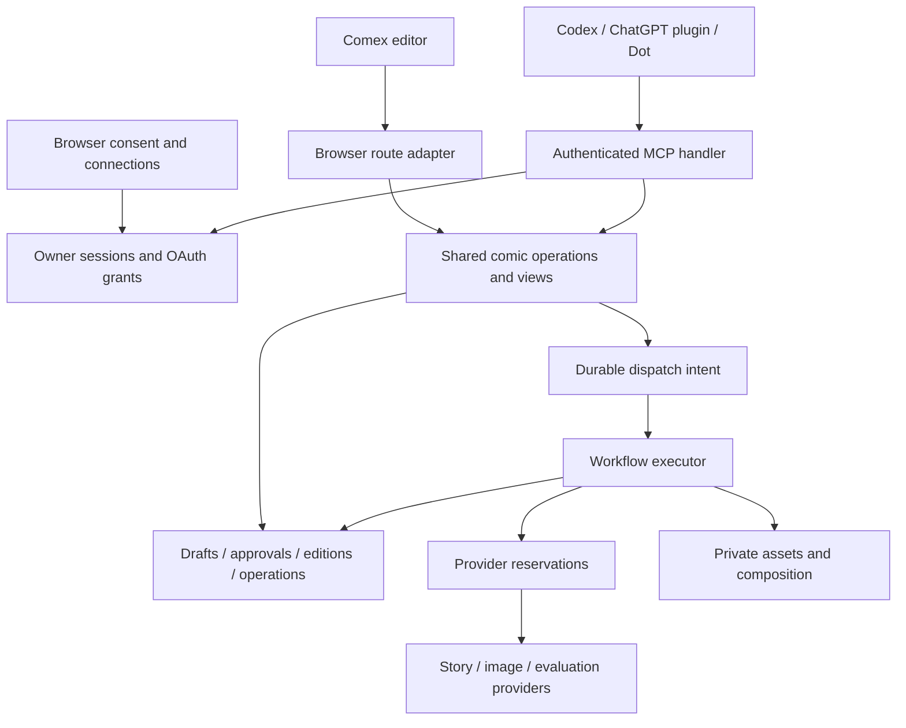
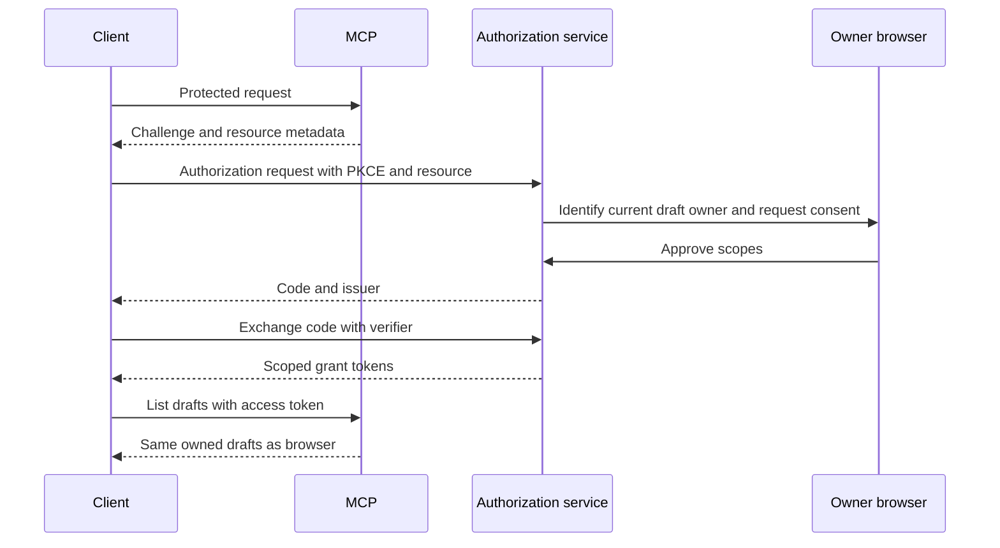
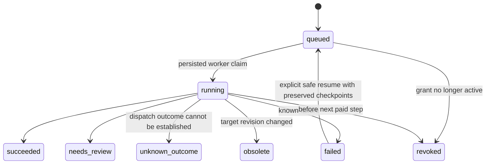

# Comex MCP Comic Creation - Plan

> **Creator clarification during implementation:** MCP should offer the same questions and review choices as the editor. The editor permits explicit, version-bound acceptance of narrative and panel blockers, so that behavior supersedes the blocker restrictions in R6 and U4 below.

## Goal Capsule

- **Objective:** Creators can make, review, revise, and share Comex comics from Codex, ChatGPT, and OpenAI Dot, continuing the same drafts in the Comex editor.
- **Means:** Authenticated remote MCP over shared application operations, with durable generation and a ChatGPT plugin connection (KTD1–KTD8).
- **Authority:** This document plans the confirmed scope. It does not authorize deployment, plugin publication, paid generation, or changes to existing samples. Implementation requires a subsequent instruction.
- **Delivery:** One implementation branch and reviewable PR, built in dependency order. Preserve the substantial uncommitted application work in this checkout; establish a reproducible baseline before isolating implementation.
- **Completion boundary:** Local protocol and application verification precede an explicitly authorized hosted rollout and real-client acceptance. An Inspector pass alone cannot establish the requested outcome.

---

## Product Contract

### Summary

Expose Comex's guided comic workflow through MCP so a conversation can create and continue a comic. Browser and connected clients share drafts, approvals, findings, jobs, and editions. Connection setup includes browser consent and revocation.

### Problem Frame

Comex's creation workflow currently lives in the browser. A conversation cannot discover a draft, supply story choices, inspect generated references, or revise a panel through a supported tool interface. Copying the workflow into a separate agent would also separate its approvals and state from the editor.

The local application has domain safeguards worth preserving, but remote connectivity requires more than wrapping its HTTP endpoints. Ownership is currently a browser-cookie capability, generation runs inside requests, and local routes deliberately reject remote hosts.

### Requirements

**Connection and ownership**

- R1. Creators can connect Codex and a ChatGPT plugin to Comex through browser consent, with OpenAI Dot using the installed plugin under its existing permissions.
- R2. A connected client and the consenting browser operate on the same owned drafts; another owner cannot read drafts, private assets, or operations by guessing IDs.
- R3. Creators can inspect and revoke individual connections without deleting comics or disconnecting their browser.

**Creation and review**

- R4. Tools support style discovery, draft creation and lookup, tailored questions and answers, character cards, reference generation, and reference approval.
- R5. Creators can inspect story beats and narrative findings and approve the exact story version before page generation. Reference and story changes invalidate affected approvals.
- R6. Clients can render pages in workflow order, inspect image previews and continuity findings, and explicitly accept eligible warning/uncertain results. Blockers remain ineligible.
- R7. Artwork edits preserve other panels; story revisions preview the affected range before applying it, preserve the unaffected prefix, and leave incomplete continuation visibly outdated.
- R8. Every result exposes enough current context to continue: revisions, pending decisions, prerequisites, next valid actions, operation IDs, and editor links. No essential flow depends on optional MCP prompts, resources, or embedded UI.

**Reliable execution and delivery**

- R9. Generation survives client disconnects; retries of the same request do not cause duplicate generation or extra provider reservations. Unknown paid outcomes remain visible and do not retry automatically.
- R10. The browser and MCP share the existing generation budget and revision protections. Concurrent edits cannot silently approve or overwrite newer content.
- R11. Private page export and public publication are separate actions. Publishing, republishing, and withdrawal require explicit user intent; draft edits leave an existing public edition unchanged.
- R12. Setup documentation and recorded acceptance cover Codex, ChatGPT, and OpenAI Dot separately, including connection, preview, approval, continuation, and revocation.

### Main Flow

Connect and consent → choose or create a draft → plot/style and tailored questions → character references and approval → story beats and approval → generate one page → inspect findings and images → accept or revise → continue pages → export privately or explicitly publish.

Any client may resume from the saved comic and operation state. Applying a story revision does not imply that every affected page has already been regenerated.

### Acceptance Examples

- AE1. Covers R1–R4, R8: create a draft in the browser, connect Codex, find the same ID, answer questions in chat, and see the answers after reloading the editor.
- AE2. Covers R5–R6, R10: after reference A is shown, another client replaces it with B; approval of A fails, and B remains unapproved. Drawing an unapproved story also fails.
- AE3. Covers R7: change page 2 panel 1 so the courier keeps the key; page 1 remains byte-identical, the affected continuation changes, and pending later pages are reported as outdated.
- AE4. Covers R9–R10: disconnect after starting a page, repeat the same request, and receive the same operation with no additional provider reservations. Reconnect and inspect its partial or final result.
- AE5. Covers R6, R11: accept an inspected uncertain panel, export privately, then explicitly publish. A signed-out reader sees only the edition; subsequent draft edits stay private, and withdrawal removes subsequent public access.
- AE6. Covers R1–R3, R12: ChatGPT and Dot can use the authorized connection; revoking that connection denies its next protected request while the browser and another independently authorized grant still work.

### Scope Boundaries

Include the application extraction, shared approvals, identity bridge, OAuth, persistence and job prerequisites required for remote operation, MCP tools, connection controls, and client guides. This request supersedes the older hackathon plan's exclusion of MCP for this work only; the older plan remains historical context.

Do not add autonomous whole-comic generation that skips creator decisions, social features, payments, account registration, comic forking, or arbitrary page layouts. Do not claim that an MCP tool annotation proves a human reviewed an image: approval tools express a user-authorized action, while server checks bind it to the inspected version.

#### Deferred to Follow-Up Work

Embedded ChatGPT comic-editor widgets, public plugin-directory submission, account recovery and cross-device login, and richer character editing are separate work. A custom MCP plugin connection is sufficient for the first release.

#### Considered and Not Built

- A second agent-specific comic store would break R2; use one workspace instead.
- A generic execute-any-action tool hides prerequisites and permissions; expose named domain tools.
- MCP Tasks and server-driven elicitation are not required for the baseline because client support can differ; ordinary tools carry the full flow.
- Automatic provider retries and cancellation guarantees are excluded because current paid outcome tracking cannot prove they are safe. Reconsider with provider reconciliation evidence.

---

## Planning Contract

### Verified Baseline

Read-only inspection on 2026-11-01 found Next.js 16.4.3, React 19.3.1, Bun 1.4.4, and Zod 4.6.7 in `package.json`. Installed Next documentation confirms Web Request/Response Route Handlers and asynchronous route params.

| Existing surface | Consequence for this work |
|---|---|
| `src/lib/local-api.ts` | Contains validation, cookie ownership, provider orchestration, assets, composition, and HTTP responses; extract shared operations before adding MCP. |
| `ensureLocal()` in that file | Rejects non-loopback hosts and Vercel. Do not expose it remotely by merely deleting the guard. |
| `src/lib/local-store.ts` | Local SQLite JSON records; both row owner and draft owner contain the session capability. No account, session registry, or grants exist. |
| `src/lib/domain/comic.ts` | Pure revision, acceptance, publication, and suffix-invalidation invariants to retain. |
| `src/lib/budget.ts` | Cumulative reservations and unknown-outcome accounting; managed storage must preserve these semantics. |
| `components/ComicEditor.tsx` | Current workflow reference, but story approval is not implemented and its job branch lacks a durable backend. |
| `app/api/local-api.test.ts` | Existing ownership, local-host, publication, paid-failure, partial-resume, and revision regression scenarios. |

The older `docs/plans/2026-11-01-1240-feat-comex-hackathon-plan.md` proposes Neon, private Blob storage, and Vercel Workflows; these are not implemented prerequisites. This plan includes their required integration rather than assuming them. No application tests or paid requests were run during planning.

### Assumptions and Deferred Execution Checks

- “Dot” means OpenAI Dot, consistent with the adjacent Codex/ChatGPT request and its official plugin documentation. Another Dot product would require a different client acceptance section, not a different comic domain.
- Preserve pseudonymous browser ownership. Connecting from a new browser without the existing session creates a separate owner; it cannot recover old drafts. Consent must make this clear.
- Hosted provisioning, exact package versions, client-account eligibility, OAuth callback URLs, and deployed runtime limits are implementation checks. They do not block local implementation, but block a claim of hosted completion until verified.
- Deployment and paid live acceptance require explicit authorization. Existing servers, samples, budget databases, and unrelated dirty files remain untouched during planning.

### Key Technical Decisions

- KTD1. **One application service, two transports.** Move orchestration and validation from `local-api.ts` into `src/lib/application/`, with explicit actor, repositories, assets, provider, budget, and executor dependencies. Browser routes retain cookie/origin handling; MCP validates bearer grants. Both call identical operations and projections. This avoids divergent workflow enforcement for R2, R4–R11.
- KTD2. **Stable pseudonymous owners with browser-approved OAuth grants.** Use maintained Better Auth anonymous sessions and its documented MCP/OAuth Provider composition, rather than implementing an authorization server from scratch or installing duplicate provider instances. Configure authorization-code/PKCE, exact resource audience, revocable grants, and CIMD with the documented `mcp-2026-07-28` metadata profile. Before committing to the pinned version, verify anonymous-session consent and refresh/revocation end to end in U3. Keep owner IDs distinct from credentials. Migrate existing ownership only after proving possession of the existing cookie, updating row and document ownership atomically; never accept an owner ID as authentication. Governs the mechanism for R1–R3. [Better Auth MCP](https://better-auth.com/docs/plugins/mcp), [CIMD](https://better-auth.com/docs/plugins/cimd).
- KTD3. **Remote Streamable HTTP, request-scoped handlers.** Use the maintained MCP TypeScript SDK's Web-standard handler in `app/mcp/route.ts`, with compatibility for older initialized clients. Pin the current stable package family after checking its release and Next/Bun compatibility; do not mix v1 examples with v2 imports. No process-memory MCP session is authoritative for comic state. [SDK source](https://github.com/modelcontextprotocol/typescript-sdk), [MCP transports](https://modelcontextprotocol.io/specification/2026-07-28/basic/transports).
- KTD4. **Hosted persistence is required for hosted access.** Follow the existing Vercel direction: Neon Postgres for application/auth/operation/budget records, private Blob storage for assets, and Vercel Workflow for durable execution. Retain SQLite/filesystem adapters for local development. All backends implement compare-and-swap, owner checks, idempotency, and budget reservations. The hosted browser adapter is enabled only with configured hosted dependencies; the local adapter keeps its host guard. [Neon transactions](https://neon.com/docs/serverless/serverless-driver), [private Blob](https://vercel.com/docs/vercel-blob/using-blob-sdk), [Workflow](https://useworkflow.dev/docs).
- KTD5. **Persist operations before dispatch.** Paid tools return a durable operation ID promptly; clients poll `comex_get_operation`. Store actor/grant, target and expected versions, idempotency key, input digest, progress, output IDs, and error state. Commit operation creation and its dispatch intent atomically; a retry can redeliver that intent without creating a second operation. Every provider step claims a unique persisted reservation before dispatch. Workflow replay after a possibly dispatched call produces `unknown_outcome`, never a second charge. This is the mechanism for R9–R10.
- KTD6. **Versioned decisions and inspectable context.** Extend shared views with store/story/reference/panel versions, full story beats and dialogue, findings, proposal impact, and allowed actions. Add explicit story approval. Reference approval and panel acceptance receive the exact displayed artifact and revision. Story revision preview/apply remains two operations; applying a revised story records approval of that proposal only and resumes the existing page-by-page review sequence. R5–R8 own behavior.
- KTD7. **Portable tool results and private previews.** Return structured results plus short text summaries. A bounded `comex_get_asset` returns authorized image content; lists return metadata instead of embedding every image. Editor and download links require browser authentication; private images never become public for chat previews. Read-only tools cannot create composed assets: export is an explicit operation. No raw owner identifiers, tokens, provider prompts, or credentials enter results.
- KTD8. **One connection, client-specific setup.** Codex supports direct remote MCP/OAuth configuration. ChatGPT adds the remote server as a custom plugin, and OpenAI Dot uses the installed plugin under its permissions. Include server instructions that describe the workflow and approval boundaries, with essential guidance in the opening 512 characters; duplicate essential next-step context in tool results. Optional workflow prompts improve discovery but are not dependencies. [Codex MCP](https://developers.openai.com/codex/mcp), [ChatGPT connection](https://developers.openai.com/plugins/deploy/connect-chatgpt), [Dot plugins](https://learn.chatgpt.com/docs/dots/computers-and-apps#connect-apps).

### Authorization Contract

Use `comex:read`, `comex:write`, `comex:generate`, and `comex:publish` as separate capabilities. Paid operations require write and generate; publication mutations require write and publish. Checks occur at the service boundary as well as discovery metadata. Keep OAuth consent browser-only. Store tokens through the library's protected storage mechanisms; logs use operation/grant IDs, not credentials.

Serve protected-resource and authorization-server metadata with exact canonical HTTPS identifiers. Require PKCE S256, audience/resource validation, expiry, scope, redirect validation, and grant revocation on every request. Prefer CIMD where the selected provider supports it; predefined clients or DCR may be compatibility fallbacks only when the relevant client needs them. Protect CIMD metadata fetching against SSRF. Match OpenAI's displayed callbacks rather than hardcoding historical URLs. Follow the [MCP authorization specification](https://modelcontextprotocol.io/specification/2026-07-28/basic/authorization) and [OpenAI authentication guide](https://developers.openai.com/plugins/build/auth).

For grants revoked during execution, deny new requests and prevent undispatched paid steps from starting; preserve completed artifacts and charged reservations. Revocation cannot undo an already dispatched provider call. A disconnected client alone does not revoke its job.

Local-to-hosted import requires a separate ownership handoff because a localhost cookie is not sent to the hosted origin. The original local browser verifies possession locally and authorizes transfer to an authenticated destination owner. Bind a short-lived, single-use transfer proof to that destination owner, canonical origin, and import batch; redeem it atomically through the destination session. Import tooling establishes the trusted batch mapping, so arbitrary local servers cannot mint claims over hosted records. Keep unclaimed imported drafts inaccessible, and never place the old cookie in URLs, MCP arguments, or exported draft content. Same-origin identity migration uses the cookie directly and needs no transfer proof.

### High-Level Technical Design

These sketches describe boundaries and contracts, not prescribed method signatures.

Workflow decisions: missing references → generate and approve; unapproved story → inspect and approve; preceding page awaiting review → inspect findings; blocker → revise/regenerate; uncertain/warning → explicit eligible acceptance; current approved page → continue or export. These are computed from persisted state, not inferred from conversation history.

Asset flow: provider bytes → private asset ID → version-checked draft association → authenticated preview → eligible page composition → optional explicit immutable publication. Public readers see only active-edition asset membership.

### Tool Surface

Names are the proposed public contract; final schema details should be settled before client documentation. Every mutation uses a client-generated request key and expected versions where existing state is modified; the same key with different arguments is a conflict.

| Workflow area | Proposed tools | Result and approval boundary |
|---|---|---|
| Discover | `comex_list_styles`, `comex_list_comics`, `comex_get_comic` | Bounded catalog/list and safe current context; no provider calls. |
| Set up | `comex_create_comic`, `comex_update_comic`, `comex_ask_questions`, `comex_add_character` | Stable IDs, supplied answers, and existing post-plan edit restrictions. |
| References | `comex_generate_reference`, `comex_approve_reference` | Operation ID or exact reference approval; no automatic approval after generation. |
| Story | `comex_plan_story`, `comex_approve_story` | Beats/dialogue/findings and exact story approval. |
| Generate | `comex_generate_page`, `comex_get_operation` | Explicit generate/resume/regenerate intent; operation state and next action. |
| Inspect | `comex_get_asset`, `comex_accept_panel` | Authorized preview or version-bound eligible acceptance. |
| Revise | `comex_edit_panel`, `comex_preview_revision`, `comex_apply_revision` | Artwork-only edit or proposal with base version and affected range. |
| Deliver | `comex_export_page`, `comex_publish_comic`, `comex_withdraw_comic` | Private artifact or explicit edition/withdrawal result. Republish uses publish with expected edition. |

Tool annotations accurately distinguish read-only, idempotent, destructive, and external effects. They guide host permission UX but never replace authorization. Protocol failures use MCP errors; domain failures use typed tool errors with current state and an actionable next step, without leaking other owners' records.

---

## Implementation Units

### U1. Extract shared comic operations and projections

**Goal:** Browser and MCP can reuse one workflow without HTTP-cookie coupling. **Requirements:** R2, R4, R6–R11. **Dependencies:** none.

**Files:** `src/lib/local-api.ts`, `src/lib/application/comics.ts` (new), `src/lib/application/contracts.ts` (new), `src/lib/application/views.ts` (new), `src/lib/domain/comic.ts`, `app/api/local-api.test.ts`, `tests/application.test.ts` (new).

**Approach:** Apply KTD1 and KTD7. Extract the current orchestration with injectable storage, asset, provider, and budget dependencies. Keep local transport protections in the route adapter and preserve current publication and revision semantics. Characterize the meaningful existing behaviors before moving them.

**Test scenarios:**

- Wrong owner receives no draft, asset, or operation data.
- Artwork edit changes only its target panel; story edit preserves the prefix and invalidates the suffix.
- Existing published edition remains unchanged after a draft edit and inaccessible after withdrawal.
- Views expose needed revisions/findings but omit credentials and internal owner data.

**Verification:** Existing domain/API scenarios and new service tests agree; extraction makes no provider calls unless the invoked operation requires them.

### U2. Add hosted persistence and preserve local data semantics

**Goal:** Remote execution has shared durable storage. **Requirements:** R2, R9–R11. **Dependencies:** U1.

**Files:** `src/lib/storage/contracts.ts` (new), `src/lib/storage/postgres.ts` (new), `src/lib/storage/assets.ts` (new), `src/lib/local-store.ts`, `src/lib/budget.ts`, `db/migrations/` (new), `tests/storage-contract.test.ts` (new), `tests/budget.test.ts`, `.env.example`, `package.json`.

**Approach:** Apply KTD4. Add schemas for owners/sessions, comics/editions, asset metadata, approvals, grants, operations/dispatch intent, and budget reservations; use auth-library migrations for its tables. Support SQLite development and Postgres hosted adapters with the same contract tests. Provide an explicit, repeatable import path that preserves IDs, editions, asset hashes, revisions, and cumulative budget/unknown reservations. Do not automatically import or mutate the live local database.

**Test scenarios:**

- Two concurrent updates against one revision yield exactly one successful commit.
- Two workers cannot reserve the same provider step or exceed the shared cap.
- A fixture import run twice preserves one copy of each comic and its total reservations.
- Private asset reads and public edition reads enforce different membership checks.

**Verification:** Contract suites pass against isolated SQLite and Postgres instances; imported fixture hashes/counts match. Actual local-data migration remains a separate authorized operation.

### U3. Connect clients to the browser's owner

**Goal:** Browser consent produces revocable, scoped access to the same drafts. **Requirements:** R1–R3, R10. **Dependencies:** U2.

**Files:** `src/lib/auth/` (new), `app/api/auth/[...all]/route.ts` (new), `app/.well-known/oauth-protected-resource/route.ts` (new), authorization discovery route as required by the pinned provider, `app/connect/page.tsx` (new), `app/connections/page.tsx` (new), `tests/auth.test.ts` (new), `e2e/connections.spec.ts` (new), `.env.example`, `package.json`.

**Approach:** Apply KTD2 and the Authorization Contract. Consent identifies the browser owner and requested actions, with a clear empty/new-workspace message. Claim legacy ownership only with its valid cookie in the original browser. Revoke one grant independently. Keep anonymous users durable while they own comics or grants; disable cleanup that would orphan their data. Start with an OAuth interoperability smoke before wiring every tool.

**Test scenarios:**

- Covers AE1: legacy cookie holder links an owner and sees the same draft IDs in browser and bearer-authenticated reads.
- A forged claim, wrong audience, expired token, missing scope, invalid PKCE verifier, or reused code fails without a mutation.
- Invalid redirect URLs and CIMD private-network fetch targets are rejected.
- Covers AE6: revoke one grant; its next request fails while another grant and browser session remain valid.
- Fresh browser consent clearly grants a new empty workspace rather than claiming existing comics.
- A local draft imported to a different origin is claimable only through the authorized transfer batch and destination session; replay, expiry, or a different destination owner fails. The localhost cookie never reaches the hosted server.

**Verification:** Full authorization-code exchange, refresh, audience/scope enforcement, and revocation work against isolated stores. No cookie or token appears in tool results or logs.

### U4. Make approvals and workflow context explicit

**Goal:** Both interfaces enforce the inspected version and expose the next valid step. **Requirements:** R4–R8, R10. **Dependencies:** U1, U2.

**Files:** `src/lib/domain/comic.ts`, `src/lib/application/comics.ts`, `src/lib/application/views.ts`, `components/ComicEditor.tsx`, `components/types.ts`, `tests/domain.test.ts`, `tests/application.test.ts`, `e2e/local.spec.ts`.

**Approach:** Apply KTD6. Add story approval and version preconditions to reference/panel approval. Update the editor to show story beats before approving, and preserve readable blockers/findings. Existing rendered drafts retain their outputs; missing story approval requires explicit review before new generation, with no retroactive fabricated approval or withdrawal of existing editions.

**Test scenarios:**

- Covers AE2: stale reference approval conflicts and leaves the replacement unapproved.
- Page generation is blocked before story approval and after a relevant story change invalidates approval.
- A blocker cannot be accepted; uncertain acceptance binds only the displayed asset/version.
- Covers AE3: a revision proposal becomes stale after another edit and cannot apply silently.

**Verification:** Browser and service tests show identical transitions and useful next-action messages; existing public editions remain readable.

### U5. Persist and execute resumable generation operations

**Goal:** Client timeout and worker replay cannot duplicate paid work. **Requirements:** R7–R10. **Dependencies:** U2–U4.

**Files:** `src/lib/operations/` (new), `src/workflows/comic-generation.ts` (new), `src/lib/application/comics.ts`, `src/lib/budget.ts`, `components/ComicEditor.tsx`, `components/api.ts`, `tests/operations.test.ts` (new), `tests/budget.test.ts`, `next.config.ts`, `package.json`.

**Approach:** Apply KTD5. Move questions, references, planning, rendering, revision preview/apply, and export composition into durable operations where they exceed a short request. Use per-step checkpoints and explicit retry classification; replace the dormant browser job branch with status polling. Scope idempotency by owner, action, and request key. Revalidate target versions and active grant before each undispatched paid step.

**Test scenarios:**

- Covers AE4: repeat a start request after a lost response; receive the same operation and one reservation sequence.
- Reuse a request key with changed arguments; reject it without new work.
- Crash after provider dispatch but before recording its response; replay reports unknown outcome without redispatch.
- Edit story while generation runs; the old output is retained as history but cannot replace current content.
- Resume a partially generated page; completed checkpoints stay intact. Explicit regenerate uses a new key.
- Revoke the initiating grant mid-page; already dispatched work is accounted for and later paid steps do not start.

**Verification:** Deterministic failure-injection tests establish checkpoints and spend behavior. A real Workflow restart smoke is required before hosted reliability is claimed.

### U6. Expose the MCP server and full tool contract

**Goal:** Standard MCP clients can carry out the workflow. **Requirements:** R1–R12. **Dependencies:** U3–U5.

**Files:** `app/mcp/route.ts` (new), `src/lib/mcp/server.ts` (new), `src/lib/mcp/tools.ts` (new), `src/lib/mcp/results.ts` (new), `tests/mcp.test.ts` (new), `tests/mcp-workflow.test.ts` (new), `package.json`.

**Approach:** Apply KTD3, KTD7, and the Tool Surface. Register strict schemas and annotations, auth discovery, workflow instructions, and compact typed results. Bound lists and image responses. Use fresh request-scoped handler state. Maintain origin validation for supplied origins without requiring browser-only headers from native clients. No generic raw HTTP or SQL tool.

**Test scenarios:**

- Initialize and list tools through supported protocol versions; unsupported versions fail explicitly.
- Missing auth returns the discovery challenge; insufficient scope fails before any provider reservation.
- Complete the comic workflow through a real MCP client harness with fake providers, including reference/story approval and private preview.
- Covers AE5: export does not publish; explicit publish creates an immutable edition and explicit withdrawal removes access.
- Story text containing tool instructions cannot change authorization, budgets, or valid state transitions.
- Tool result data matches its output schema on success, review-needed, conflict, and unknown-outcome paths.

**Verification:** MCP Inspector plus integration harness exercise actual HTTP serialization and authentication. Browser/MCP outcomes match under the same fixtures.

### U7. Prepare hosted configuration and connection guides

**Goal:** A creator has a short, accurate connection path for each client. **Requirements:** R1–R3, R8, R12. **Dependencies:** U6.

**Files:** `docs/mcp.md` (new), `docs/setup.md`, `README.md`, `.env.example`, `app/connections/page.tsx`, `app/api/[...segments]/route.ts`, `src/lib/hosted-api.ts` (new), `tests/hosted-config.test.ts` (new), `e2e/connections.spec.ts`.

**Approach:** Apply KTD4 and KTD8. Document canonical endpoint, scopes, browser identity limitations, exact client callbacks, installation, revocation, and troubleshooting. Hosted mode must fail closed when database, assets, auth, or executor configuration is missing. Include Codex remote configuration and ChatGPT's custom MCP-to-plugin path; explain that Dot uses that installed plugin. Keep existing local guard behavior. Resolve secrets from the established 1Password setup without embedding them in generated configuration.

**Test scenarios:**

- Local API still rejects an untrusted remote host; hosted routes require configured managed adapters and authenticated ownership.
- Missing required hosted configuration prevents paid or private operations with a clear diagnostic.
- Keyboard-only browser flow can consent, inspect scopes, revoke, and return to a draft.
- Reconnect after token expiry restores access only to the correct owner.

**Verification:** Local production build and configuration tests pass. Reviewable deployment settings are prepared; no deploy or plugin publication happens implicitly.

### U8. Prove client behavior and document boundaries

**Goal:** Record evidence for the actual creator outcome on each surface. **Requirements:** R1–R12. **Dependencies:** U7; authorized hosted test environment and paid budget for live generation.

**Files:** `e2e/mcp-parity.spec.ts` (new), `evals/mcp/workflow-cases.md` (new), `docs/research/mcp-acceptance.md` (new), `docs/mcp.md`.

**Approach:** Start with deterministic fake-provider flows and a bounded local client harness. After deployment/test authorization, exercise real Codex, ChatGPT, and Dot connections independently. Reuse a dedicated sample and cumulative budget accounting. Record client/version, chosen tools, approvals, image visibility, operation IDs, resulting draft/edition IDs, and failure boundaries without tokens.

**Test scenarios:**

- Covers AE1–AE6 across the harness and real clients, including cross-client continuation and revoked access.
- Ask each client to make a comic; it asks meaningful questions and presents required approval points rather than auto-accepting findings.
- Ask for a lighting-only edit; neighboring hashes stay identical.
- Ask to export, without asking to publish; no public edition appears.
- Interrupt the conversation during generation; resume against the existing operation rather than regenerate.

**Verification:** Distinguish protocol pass, mock parity, hosted execution, and each real-client pass. Any missing account permission or unsupported preview behavior remains an explicit acceptance gap, with a working browser-review fallback tested.

---

## Verification Contract

| Gate | Evidence required |
|---|---|
| Static and regression | `bun run typecheck`, `bun run test`, and `bun run build` pass on the implementation snapshot. Extend the test script to include new suites. |
| Storage and auth | Isolated local and Postgres contract tests, migration fixtures, OAuth code/refresh/revocation flow, and wrong-owner/scope cases. |
| Browser | `bun run test:e2e` covers consent, approvals, reconnect, and shared draft continuation against an isolated server. |
| Protocol | Inspector and MCP client harness prove initialization, discovery, tool schemas, auth errors, images, and complete fake-provider workflow. |
| Durability | Failure injection proves no duplicate paid dispatch, stale-result rejection, partial resume, and honest unknown outcomes. |
| Hosted and clients | Authorized deployment smoke and separate Codex/ChatGPT/Dot acceptance records. A local pass does not satisfy this gate. |

Use isolated data/assets and fake providers by default. Do not write to the protected existing sample, reset reservation history, or stop pre-existing servers. Live calls require an agreed finite budget and explicit authorization.

---

## Definition of Done

Implementation is reviewable when U1–U7 pass their local gates and the PR contains the full U8 acceptance procedure. The feature is complete for users only when the hosted and three real-client gates also pass, with any deliberate limitations stated in `docs/mcp.md`.

The essential proof is one coherent, inspectable comic created through the conversation workflow, continued in the browser, safely revised, exported privately, and optionally published by explicit request. OAuth connectivity alone is insufficient.

---

## Appendix

### Sources

- Local implementation: `src/lib/local-api.ts`, `src/lib/local-store.ts`, `src/lib/domain/comic.ts`, `src/lib/budget.ts`, `components/ComicEditor.tsx`, `app/api/local-api.test.ts`.
- Local framework contract: `node_modules/next/dist/docs/01-app/03-api-reference/03-file-conventions/route.md`.
- Existing product intent: `docs/plans/2026-11-01-1240-feat-comex-hackathon-plan.md` and `README.md`.
- [MCP TypeScript SDK](https://github.com/modelcontextprotocol/typescript-sdk) and [MCP authorization](https://modelcontextprotocol.io/specification/2026-07-28/basic/authorization).
- [Better Auth anonymous sessions](https://www.better-auth.com/docs/plugins/anonymous) and [OAuth Provider](https://www.better-auth.com/docs/plugins/oauth-provider).
- [OpenAI authentication](https://developers.openai.com/plugins/build/auth), [custom MCP plugin connection](https://developers.openai.com/plugins/deploy/connect-chatgpt), [Codex MCP](https://developers.openai.com/codex/mcp), and [Dot connected apps](https://learn.chatgpt.com/docs/dots/computers-and-apps#connect-apps).

External guidance was checked during planning; package pinning and real-client/runtime behavior remain implementation evidence.
